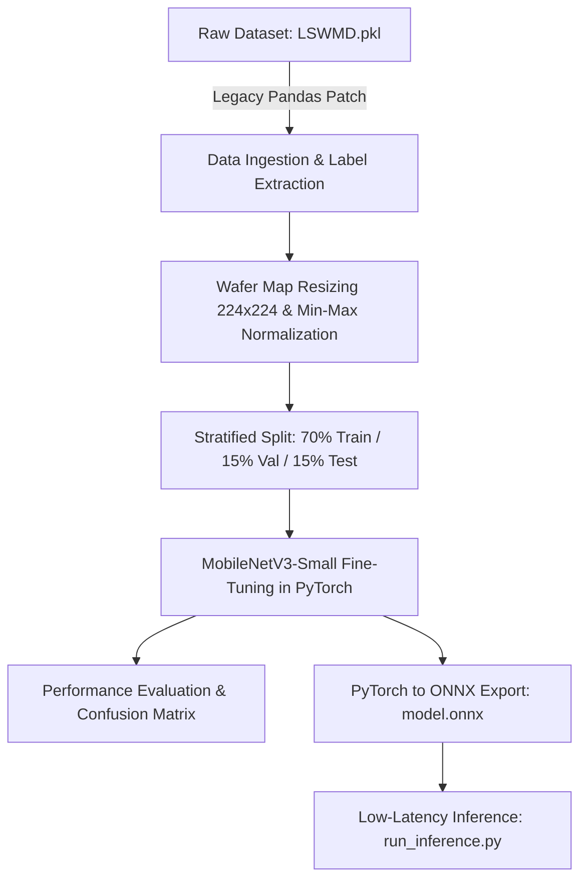

# Automated Semiconductor Wafer Defect Classification Pipeline

An end-to-end deep learning and edge deployment pipeline for classifying semiconductor wafer defects using the **WM-811K (LSWMD)** dataset, fine-tuning **MobileNetV3-Small**, and exporting to **ONNX Runtime** for real-time fab edge inference.

---

## 📌 Project Overview & Team Metadata

- **Project Title**: End-to-End Deep Learning Pipeline for Automated Semiconductor Wafer Defect Classification with ONNX Optimization
- **Institution**: Saintgits College of Engineering (Autonomous)
- **Department**: Department of Computer Science and Engineering
- **Project Area**: Machine Learning / Semiconductor Quality Assurance
- **Project Phase**: B.Tech Mini Project Phase - 1
- **Team Members**:
  - **Adithyan B** (`MGP23EVLSI001`)
  - **Anna Boban** (`MGP23EVLSI002`)
  - **Noopa Maria Rojan** (`MGP23EVLSI009`)
- **Project Supervisor**: **Er. Justin Mathew**, Assistant Professor, Dept. of CSE

---

## 🌟 Key Features

1. **Automated Legacy Dataset Parsing & ETL Engine**:
   - Resolves legacy Python 2 / Pandas 1.x pickle incompatibilities (`LSWMD.pkl`) using monkeypatching for `pandas.indexes` and `pandas.core.indexes.numeric`.
   - Converts raw wafer topological grid matrices into standardized $224 \times 224$ 8-bit grayscale images.
   - Performs stratified dataset splitting into **Train (70%)**, **Validation (15%)**, and **Test (15%)**.

2. **Lightweight MobileNetV3-Small Deep Learning Architecture**:
   - Uses pre-trained MobileNetV3-Small with depthwise separable convolutions and hard-swish activations for low latency and minimal parameter footprint.
   - Custom 8-class linear classification head fine-tuned with Adam optimizer ($\text{lr} = 3 \times 10^{-4}$) and Cross-Entropy loss.

3. **Open ONNX Format Optimization**:
   - Serializes trained PyTorch weights into **ONNX (opset 12)** format with dynamic batch axes (`model.onnx`).
   - Enables lightweight, dependency-free CPU/edge inference via **ONNX Runtime**.

4. **Standalone Edge Inference Engine**:
   - CLI utility `run_inference.py` for instant defect classification on single wafer images with top-3 probability confidence scores.

5. **Empirical Benchmarking & Results Tracking**:
   - Automatically generates loss/accuracy logs per epoch, per-class classification reports, and a high-resolution confusion matrix heatmap.

---

## 🏗️ Pipeline Architecture



---

## 📁 Repository Directory Structure

```text
semiconductor-defect-classification/
├── LSWMD.pkl/                      # Raw dataset directory
│   └── LSWMD.pkl                   # Raw pickle dataset (WM-811K)
├── output/                         # Automatically generated artifacts
│   ├── Dataset/                    # Processed image splits
│   │   ├── Train/                  # Training set (70%)
│   │   ├── Validation/             # Validation set (15%)
│   │   └── Test/                   # Testing set (15%)
│   ├── models/                     # Trained models
│   │   ├── mobilenetv3_lswmd.pth   # PyTorch model weights
│   │   └── model.onnx              # Optimized ONNX model
│   └── results/                    # Quantitative & visual metrics
│       ├── confusion_matrix.png    # Confusion matrix heatmap plot
│       ├── metrics_summary.txt     # Accuracy, Precision, Recall & Classification Report
│       └── training_logs.txt       # Per-epoch loss and accuracy metrics
├── train_lswmd_mobilenetv3_onnx.py # Main training & export pipeline script
├── run_inference.py                # Standalone ONNX inference CLI
├── convert_pkl_to_images.py        # Utility script to dump PNG images per class
├── presentation.pptx               # Zeroth Review PowerPoint Presentation
├── presentation_updated.pptx       # Updated Zeroth Review PowerPoint backup
└── README.md                       # Complete project documentation
```

---

## 🏷️ Wafer Defect Class Mapping

The raw **WM-811K (LSWMD)** dataset contains raw defect strings that are standardized into 8 target classes:

| Target Class | Raw WM-811K Label | Physical Description |
| :--- | :--- | :--- |
| `clean` | `none` or `NaN` | Normal wafer with no topological defects. |
| `center` | `Center` | Cluster of failing die located in the wafer center. |
| `donut` | `Donut` | Ring-shaped defect distribution around the center. |
| `edge_loc` | `Edge-Loc` | Concentrated defect pattern on the wafer periphery. |
| `edge_ring` | `Edge-Ring` | Continuous defect ring along the outer edge. |
| `loc` | `Loc` | Localized defect spot away from center or edge. |
| `scratch` | `Scratch` | Linear defect line across wafer caused by handling tool scratches. |
| `other` | `Random`, `Near-full` | High-density random noise or near-total wafer failure. |

---

## 📊 Empirical Performance & Results

The MobileNetV3-Small model was trained for **8 epochs** on the stratified dataset split ($121,719$ test wafer maps):

### Overall Metrics

- **Overall Test Accuracy**: **`98.02%`**
- **Macro Precision**: `0.69`
- **Macro Recall**: `0.62`
- **Weighted Precision / Recall / F1-Score**: **`0.98 / 0.98 / 0.98`**

### Per-Class Classification Report

| Class | Precision | Recall | F1-Score | Test Support |
| :--- | :---: | :---: | :---: | :---: |
| **`center`** | 0.70 | 0.34 | 0.45 | 644 |
| **`clean`** | **0.99** | **0.99** | **0.99** | **117,891** |
| **`donut`** | 0.73 | 0.67 | 0.70 | 83 |
| **`edge_loc`** | 0.63 | 0.56 | 0.59 | 779 |
| **`edge_ring`** | **0.87** | **0.76** | **0.81** | **1,452** |
| **`loc`** | 0.52 | 0.53 | 0.53 | 539 |
| **`other`** | 0.60 | 0.70 | 0.64 | 152 |
| **`scratch`** | 0.48 | 0.39 | 0.43 | 179 |
| **Overall / Total** | **0.98** | **0.98** | **0.98** | **121,719** |

---

## 🚀 Quickstart & Usage Guide

### 1. Prerequisites & Environment Setup

Ensure **Python 3.8+** and PyTorch are installed.

```bash
pip install numpy pandas opencv-python torch torchvision scikit-learn matplotlib seaborn onnx onnxruntime tqdm pillow python-pptx
```

Ensure the dataset pickle file `LSWMD.pkl` is located at `LSWMD.pkl/LSWMD.pkl` relative to the repository root.

---

### 2. Run Main Training & Export Pipeline

To run the complete data extraction, training, evaluation, and ONNX export pipeline:

```bash
python train_lswmd_mobilenetv3_onnx.py
```

- **Note**: The first execution parses `LSWMD.pkl` and creates the `output/Dataset/` directory. Subsequent runs will automatically detect existing dataset directories and proceed directly to training/evaluation.

---

### 3. Run Inference on Single Wafer Images

Use `run_inference.py` to classify any wafer image using the optimized ONNX model:

```bash
python run_inference.py output/Dataset/Test/scratch/scratch_12345.png
```

**Sample Output**:
```text
[INFO] Running inference on: output/Dataset/Test/scratch/scratch_12345.png

Prediction: SCRATCH
Confidence: 89.42%
------------------------------
Top 3 Probabilities:
  scratch   : 89.42%
  loc       : 6.18%
  edge_loc  : 2.85%
```

---

### 4. Export PNG Wafer Images (Optional Utility)

To export a subset of sample PNG images per class from the raw pickle file for inspection:

```bash
python convert_pkl_to_images.py --limit-per-class 100 --output-dir wafer_images
```

---

## 🔧 Script & Module Descriptions

| Script | Purpose & Functionality |
| :--- | :--- |
| [train_lswmd_mobilenetv3_onnx.py](file:///c:/Users/hp/Downloads/semiconductor-defect-classification/train_lswmd_mobilenetv3_onnx.py) | **Main Pipeline Engine**: Patches pandas, parses `LSWMD.pkl`, pre-processes images, trains MobileNetV3-Small, evaluates metrics, and exports `model.onnx`. |
| [run_inference.py](file:///c:/Users/hp/Downloads/semiconductor-defect-classification/run_inference.py) | **Inference CLI**: Loads `output/models/model.onnx` with ONNX Runtime, preprocesses grayscale input image to ImageNet normalized tensor, and returns top predictions. |
| [convert_pkl_to_images.py](file:///c:/Users/hp/Downloads/semiconductor-defect-classification/convert_pkl_to_images.py) | **Dataset Dump Utility**: Extracts raw wafer maps from pickle to disk as PNG images sorted by class folders. |

---

## 🛠️ Troubleshooting & Technical Gotchas

1. **Pandas Pickle Unpickling Error (`AttributeError: Can't get attribute 'Int64Index'`)**:
   - Modern Pandas versions ($\ge 2.0$) removed `Int64Index` and relocated index classes. The `patch_pandas()` helper in our pipeline dynamically aliases these modules back to `pandas.Index` before loading `LSWMD.pkl`.
2. **GPU vs CPU Execution**:
   - The script automatically detects CUDA (`torch.cuda.is_available()`). On CPU, training 8 epochs over 800k records may take extended time; leverage GPU acceleration where available.
3. **ONNX Dynamic Axes**:
   - The exported ONNX model supports dynamic batch sizes (`dynamic_axes={'input': {0: 'batch_size'}}`), allowing single-image or batch-image inference seamlessly.

---

## 🗺️ Project Roadmap (Phase 2)

- [x] Phase 1 Zeroth Review & Slides Deck (`presentation.pptx`).
- [x] Data ingestion, MobileNetV3-Small PyTorch fine-tuning, and ONNX export.
- [ ] **INT8 / FP16 Model Quantization**: Further compress `model.onnx` size from ~9MB to ~2.5MB for microcontroller deployment.
- [ ] **Edge Hardware Latency Profiling**: Test ONNX Runtime latency on NVIDIA Jetson Orin Nano & Raspberry Pi 4.
- [ ] **Operator Web Dashboard**: Build an interactive web GUI (Streamlit / FastHTML) for uploading wafer map files and viewing defect probability heatmaps.

---

## 📄 License & Acknowledgments

- **Dataset**: WM-811K (LSWMD) dataset provided for academic research.
- **Frameworks**: PyTorch, ONNX Runtime, OpenCV, Scikit-Learn.
